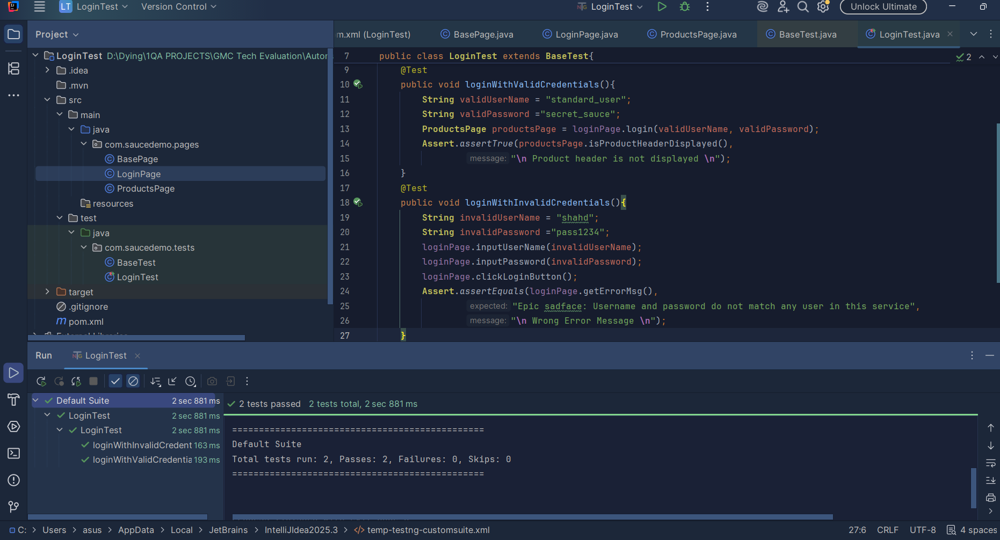

# Login Page Automation Testing

## 1. Project Overview

Small-scale automated tests for login functionality using Selenium WebDriver, Java, and TestNG.

## 2. Tools & Technologies

- **Programming Language:** Java
- **Automation Tool:** Selenium WebDriver
- **Testing Framework:** TestNG
- **IDE:** IntelliJ IDEA
- **Web Browser:** Microsoft Edge

## 3. Application Under Test

- **Website:** SauceDemo
- **URL:** https://www.saucedemo.com/

## 4. Automated Test Scenarios

### TC-01: Valid Login

- **Scenario:** User logs in with valid credentials.
- **Assertion:** Verify that the user is redirected to the Products page by checking the visibility of the Products header.

### TC-02: Invalid Login

- **Scenario:** User attempts to log in with invalid credentials.
- **Assertion:** Verify that the displayed error message matches the expected error message.

## 5. Project Structure

### Pages

1. **BasePage:** Contains the WebDriver instance and commonly used methods.
2. **LoginPage:** Contains the login page locators and methods used to interact with the page.
3. **ProductsPage:** Contains the locator for the Products header and a method to verify its visibility.

### Tests

1. **BaseTest:** 
   - Initializes the WebDriver and LoginPage before each test using `@BeforeMethod`.
   - Contains the `@AfterMethod` method, which closes the browser and terminates the WebDriver session.

2. **LoginTest:**
   - Contains the two login test cases.
   - Uses TestNG's `@Test` annotation and assertions to verify the expected results.

## 6. Prerequisites

Make sure the following are installed:

- Java JDK
- IntelliJ IDEA or another Java IDE
- Microsoft Edge
- Selenium WebDriver
- TestNG

## 7. How to Run the Project

1. Clone or download this repository.
2. Open the project in IntelliJ IDEA.
3. Make sure all required dependencies are configured.
4. Run the `LoginTest` TestNG class.
5. Check the TestNG results to verify the test execution status.

## 8. Test Execution Results

The following screenshot shows the TestNG test execution results:

